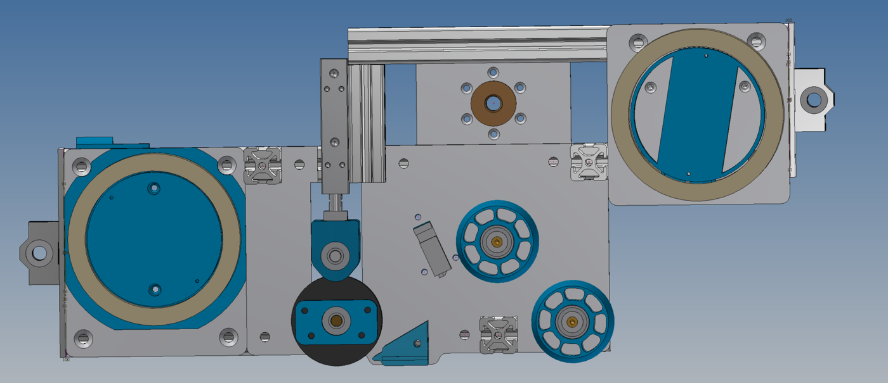
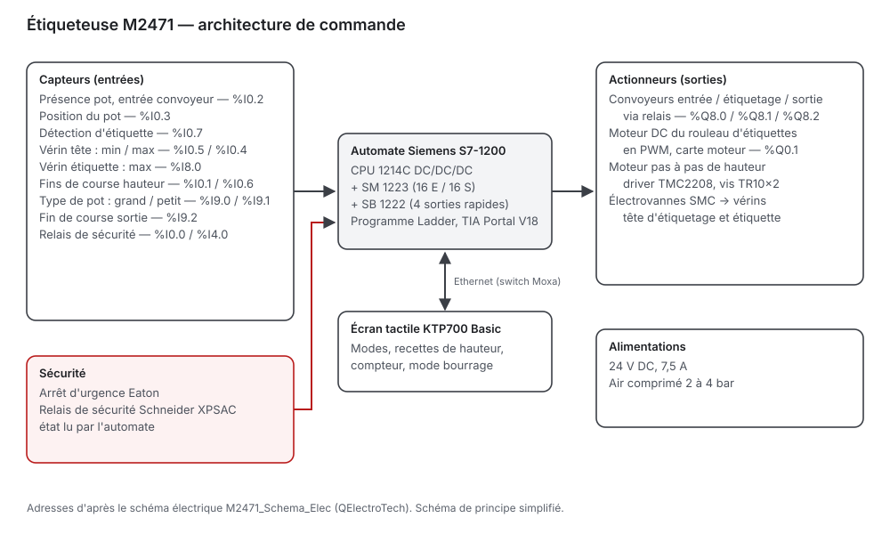

# Étiqueteuse automatique de pots de miel (M2471)

Machine qui pose automatiquement une étiquette sur des pots de miel de deux formats normés. Elle est commandée par un automate Siemens S7-1200 et un écran tactile KTP700, et la hauteur d'étiquetage s'adapte au pot.

Projet de fin d'année du Module Complémentaire Technique (MCT) au CPNV, à Yverdon-les-Bains, du 11 mars au 30 juin 2024. Réalisé à deux par Guilhem Rozier Vilardell et Mattéo Pozzo di Borgo, qui ont mené ensemble la quasi-totalité du projet : conception, études, fabrication, câblage et programmation.

## Contenu du dépôt

| Dossier | Contenu |
|---|---|
| `docs/` | Cahier des charges et bilan, études techniques, rapport de transmission, mode d'emploi, coûts, planning, poster et présentations |
| `schemas/` | Schéma électrique et schéma pneumatique (QElectroTech `.qet` + PDF) |
| `automate/` | Projet TIA Portal V18 (automate S7-1200 + écran KTP700 Basic) |
| `cao/` | Modèles Inventor de la machine (assemblage général `M2471_EG.iam`), mises en plan et fichiers d'impression 3D |

## Fonctionnement

La machine comporte trois zones :

1. **Chargement** : un convoyeur amène les pots. Un système de retenue les espace, et des fins de course reconnaissent le format du pot.
2. **Étiquetage** : le pot est mis en rotation contre la tête d'étiquetage. L'étiquette est décollée de son support, puis plaquée par un rouleau monté sur un vérin. L'ensemble se déplace en hauteur grâce à un moteur pas à pas et une vis trapézoïdale TR10×2.
3. **Déchargement** : les pots étiquetés, et ceux qui ne correspondent pas au mode choisi (laissés sans étiquette), sont évacués sur le convoyeur de sortie.

Les pots et les étiquettes sont normalisés (étude 001) :

| Profil | Diamètre | Hauteur avec couvercle |
|---|---|---|
| Grand pot | 80 mm ± 0,2 mm | 133,5 mm ± 0,5 mm |
| Petit pot | 65 mm ± 0,5 mm | 86 mm ± 0,5 mm |
| Étiquette | 40 × 80 mm, rouleau Ø intérieur 76 mm, hauteur 110 mm | |

## Architecture de commande

- Automate : Siemens S7-1200, CPU 1214C DC/DC/DC, avec un module SM 1223 (16 entrées / 16 sorties) et une carte SB 1222
- Écran : Siemens KTP700 Basic, relié par Ethernet via un switch Moxa
- Actionneurs : 3 convoyeurs à moteur DC, un moteur DC pour le rouleau d'étiquettes (commandé en PWM), un moteur pas à pas pour la hauteur (driver TMC2208), un vérin Festo DFM-16 et un vérin SMC CXSJM10 commandés par électrovannes SMC
- Capteurs : photoélectriques Baumer et Panasonic, fins de course Omron, capteurs de position des vérins
- Sécurité : arrêt d'urgence et relais de sécurité Schneider XPSAC
- Alimentation : 24 V DC, 7,5 A ; air comprimé de 2 à 4 bar

Le détail des entrées et sorties est dans `schemas/M2471_Schema_Elec.pdf`.

## Interface opérateur

L'écran tactile propose quatre modes :

- **Ø80 × 133 mm** : n'étiquette que les grands pots ;
- **Ø65 × 86 mm** : n'étiquette que les petits pots ;
- **Automatique** : étiquette les deux formats, chacun à sa hauteur ;
- **Manuel** : n'importe quel pot, à une hauteur fixe choisie par l'opérateur.

Chaque mode a son compteur de pots et peut s'arrêter seul une fois atteint un objectif fixé. Les hauteurs par défaut se règlent dans des **recettes**. Après une erreur ou un arrêt d'urgence, la machine passe en **mode bourrage** et attend que l'opérateur valide une liste de vérifications. La procédure complète est dans `docs/M2471_Mise_Service.pdf`.

## Cahier des charges et résultats

| Exigence | Demandé | Obtenu |
|---|---|---|
| Cadence | au moins la cadence manuelle, 6 pots/min | 12 pots/min |
| Taux de réussite | 98 % minimum | 82 % |
| Encombrement | 600 × 600 × 600 mm | 600 × 800 × 400 mm avec le boîtier électrique externe (conforme sans lui) |
| Deux profils de pots préprogrammés, écran de commande, comptage, réglage de hauteur automatique, contrôle du type de pot | oui | réalisé |

**Cadence manuelle de référence** (étude 002) : 25 étiquettes ont été posées à la main.

- Temps moyen : 11,66 s par pot, soit 60 / 11,66 = 5,1 pots/min. L'étude retient 6 pots/min.
- Centrage réussi : 15 / 25 = 60 %, avec une tolérance de ± 2 mm.

**Cadence de la machine** : 12 pots/min, soit 60 / 12 = 5 s par pot. C'est 11,66 / 5 ≈ 2,3 fois plus rapide que le geste manuel.

**Fiabilité** : avec un taux de réussite de 82 %, on compte en moyenne 18 pots ratés sur 100, contre 2 au plus avec l'objectif de 98 %. Deux causes ont été identifiées :

- l'étiquette se plie quand elle sort trop tôt, avant l'arrivée du pot ;
- les étiquettes dévient et doivent être recentrées à la main environ toutes les 20 étiquettes.

## Coûts

| Poste | Calcul | Montant |
|---|---|---|
| Matériel | liste de pièces (`docs/M2471_Couts.pdf`) | 7 374,12 CHF |
| Fabrication | 170 h × 50 CHF/h | 8 500,00 CHF |
| Développement | 980 h × 50 CHF/h | 49 000,00 CHF |
| **Total** | 7 374,12 + 8 500 + 49 000 | **64 874,12 CHF** |

Au total : 980 h de développement et 170 h de fabrication, soit 1 150 h.

## Pistes d'amélioration (rapport de transmission)

- **Freinage du rouleau d'étiquettes** : les rouleaux bombés et les freins légers ont réduit la déviation, mais ils augmentent la force que doivent transmettre les mâchoires de motorisation. Celles-ci doivent être renforcées (étude 007).
- **Réglage de hauteur** :
  - passer à des axes d'au moins 14 mm de diamètre (8 mm actuellement), trempés après usinage ;
  - placer le moteur exactement au centre de gravité, ou mieux, mettre un moteur à côté de chaque axe.
- **Système d'étiquetage** : aujourd'hui, la rotation du pot et le défilement des étiquettes sont liés mécaniquement, si bien qu'on ne peut pas faire tourner le pot sans étiqueter. Pour bien presser l'étiquette en fin de pose, il faudrait :
  - entraîner le rouleau de rotation en prise directe ;
  - entraîner le rouleau d'impression par courroie ;
  - n'engager le défilement de l'étiquette que lorsque le vérin est sorti.

## Ouvrir les fichiers

- `automate/` : ouvrir `M2471_Etiqueteuse.ap18` avec **TIA Portal V18** (STEP 7 Basic et WinCC Basic).
- `schemas/` : [QElectroTech](https://qelectrotech.org/) (gratuit), ou directement les PDF.
- `cao/` : **Autodesk Inventor**, en ouvrant le projet `M2471_Etiqueteuse.ipj` puis l'assemblage `M2471_EG.iam`. Les pièces imprimées existent aussi en `.stl` / `.obj`.

## Auteurs et licence

Guilhem Rozier Vilardell et Mattéo Pozzo di Borgo, MCT, CPNV, 2024.

Les documents, schémas, modèles CAO et le projet d'automate sont mis à disposition sous licence **CC BY-NC-SA 4.0** (voir [LICENSE.md](LICENSE.md)). Les modèles 3D de composants du commerce (Siemens, Festo, SMC, item, Panasonic…) restent la propriété de leurs fabricants.
